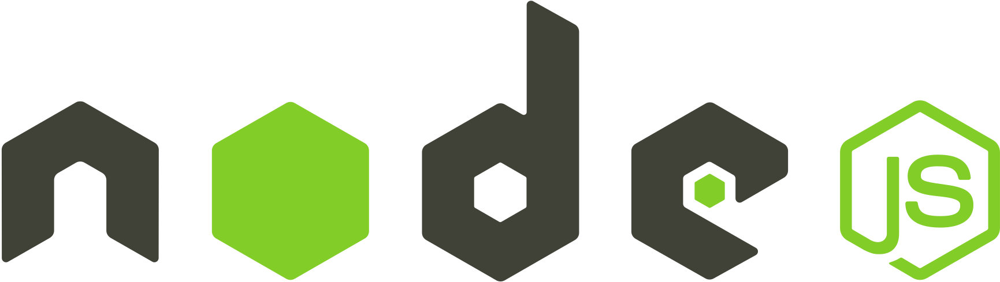

<h1 align="center">
  
  <br />
  <a href="https://www.linkedin.com/in/alexandre-costa-401699199">
    
  </a>
  <a href="https://github.com/alexandredev3/Node.js-API-solid-principles/issues">
    
  </a>
  <a href="https://github.com/alexandredev3/linkedin-clone//network">
    
  </a>
  <a href="https://github.com/alexandredev3/linkedin-clone//stargazers">
    
  </a>
</h1>
<p align="center">
  <a href="#page_facing_up-descrição">Descripción</a>&nbsp;&nbsp;&nbsp;|&nbsp;&nbsp;&nbsp;
  <a href="#-tecnologias">Tecnologías</a>&nbsp;&nbsp;&nbsp;|&nbsp;&nbsp;&nbsp;
    <a href="#clipboard-Funcionalidades">Funcionalidades</a>&nbsp;&nbsp;&nbsp;|&nbsp;&nbsp;&nbsp;
  <a href="#closed_book-instalação">Instalación</a>&nbsp;&nbsp;&nbsp;|&nbsp;&nbsp;&nbsp;
  <a href="#man-Autor">Autor</a>&nbsp;&nbsp;&nbsp;|&nbsp;&nbsp;&nbsp;
</p>

## :page_facing_up: Descripción
API de autenticación de usuario con arquitectura en capas, siguiendo los conceptos de SOLID y el patrón de diseño de Inversión de Dependencias (Dependency Injection) en Node.js y TypeScript.

## 🛠 Tecnologías
Este proyecto fue desarrollado con las siguientes tecnologías
### App
  - [Typescript](https://www.typescriptlang.org/)
  - [Node.js](https://nodejs.org/)
  - [Tsyringe](https://github.com/microsoft/tsyringe)
  - [Express](https://expressjs.com/pt-br/)
  - [Celebrate](https://github.com/arb/celebrate)
 
### Base de Datos
  - [Typeorm](https://typeorm.io/#/)
  - [Postgres](https://www.postgresql.org/)
  - [Redis](https://redis.io/)
  
### Pruebas
  - [Jest](https://jestjs.io/)
  
## :clipboard: Funcionalidades
  - [x] Crear usuarios.
  - [x] Autenticar un usuario.
  - [x] Lista todos los usuarios guardados en la base de datos.
  - [x] Guardar usuarios listados en un sistema de Caché.
  - [x] Cargar usuarios que fueron guardados en el Caché.
 
## :closed_book: Instalación

### Prerrequisitos
Antes de comenzar, necesitas tener instaladas en tu máquina las siguientes herramientas:
[Git](https://git-scm.com), [Node.js](https://nodejs.org/en/).
Además, es recomendable tener un editor para trabajar con el código como [VSCode](https://code.visualstudio.com/)

#### Iniciando el Back-End
  ```bash
  # Clona este repositorio;
  $ git clone https://github.com/alexandredev3/nodejs-clean-architeture.git

  # Ve al directorio donde está la app;
  $ cd nodejs-clean-architeture

  # Instala las dependencias;
  $ yarn o npm install

  # Ejecuta la aplicación;
  $ yarn dev o npm run dev

  # La app estará corriendo en el puerto 3333 - accede a <http://localhost:3333>
  ```
  
#### Ejecutando Pruebas
  ```bash
  # Ejecutando las pruebas con Jest;
  $ yarn test o npm run tests
  ```
## Clean Architecture


## Estructura de Carpetas


## :man: Autor

<a href="https://github.com/alexandredev3/">
 
 <br />
 <sub><b>Alexandre Costa</b></sub>
</a>


Hecho con ❤️ por Alexandre Costa :wave::wave: ¡Contáctame!🚀

<a href="https://www.linkedin.com/in/alexandre-costa-401699199">
  
</a>
